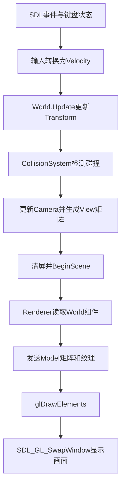

# MiniGameRuntime 阶段5学习总结

> 主题：图形学与实时渲染入门  
> 技术路线：C++20 + SDL2 + OpenGL 3.3 Core + GLAD + stb_image  
> 完成日期：2026-11-04  
> 最终产物：能够运行的 MiniRenderer Sandbox Demo

---

## 1. 阶段目标

阶段5的目标不是从零默写一套完整渲染器，也不是记住所有 OpenGL 函数，而是建立从游戏数据到屏幕像素的完整认识：

```text
游戏实体与组件
→ 输入与游戏状态更新
→ 模型矩阵和观察矩阵
→ Shader
→ 顶点、索引和纹理
→ OpenGL绘制
→ SDL窗口显示
```

原计划为6周、约30个学习日。实际学习过程中，为了降低一次引入过多概念造成的理解负担，将纹理、Sprite、Camera、Renderer、World整合以及测试拆成了更小的任务，最终扩展到约41个学习日。学习范围没有扩大，主要是增加了理解、调试和复盘时间。

---

## 2. 最终完成的功能

当前 Demo 已经具备：

- 使用 SDL2 创建窗口和 OpenGL 上下文；
- 使用 GLAD 加载 OpenGL 3.3 Core 函数；
- 使用高精度计时器计算每帧 `deltaTime`；
- 处理窗口关闭、Esc退出和持续按键输入；
- 使用 WASD 控制玩家实体移动；
- 对移动方向进行归一化，避免斜向移动更快；
- 使用方向键移动二维摄像机；
- 使用 VAO、VBO、EBO 保存和描述矩形网格；
- 使用顶点着色器和片段着色器完成绘制；
- 使用 Model Matrix 控制物体的位置、旋转和缩放；
- 使用 View Matrix 表示摄像机观察变换；
- 使用 stb_image 读取 PNG 像素；
- 将图片上传为 OpenGL 二维纹理；
- 使用 Alpha 混合显示透明贴图；
- 使用 `World` 保存实体的 Transform、Velocity 和 AABB；
- 使用 `CollisionSystem` 检测实体碰撞；
- 由 Renderer 从 World 中读取实体数据并绘制；
- 在退出前释放 OpenGL、SDL和图片相关资源；
- 对 Shader 编译和程序链接错误进行检查并输出日志；
- 能够通过 CMake 完成依赖配置、编译和运行。

---

## 3. 当前程序结构

### 3.1 模块职责

| 模块 | 主要职责 |
| --- | --- |
| `main()` | 创建资源，组织输入、更新、碰撞、渲染和退出顺序 |
| SDL2 | 创建窗口，处理输入、事件、时间和交换缓冲区 |
| OpenGL | 管理GPU资源并执行绘制命令 |
| GLAD | 在运行时取得OpenGL函数地址 |
| stb_image | 从磁盘读取并解码图片像素 |
| Shader | 决定顶点最终位置以及像素颜色 |
| `World` | 保存实体和组件，按照速度更新位置 |
| `CollisionSystem` | 查找具有Transform和AABB的实体并检查碰撞 |
| `Renderer` | 把实体组件转换为OpenGL绘制命令 |
| `Camera2D` | 保存摄像机位置，生成观察变换所需数据 |

### 3.2 一帧的执行流程



这个顺序的核心是：

> 先更新游戏状态，再根据最新状态绘制画面。

---

## 4. 数据如何走到屏幕

以玩家按下 `D` 键为例：

1. `SDL_GetKeyboardState()`检测到D键正在按下；
2. 输入代码得到方向 `(1, 0)`；
3. 方向乘以移动速度，写入玩家的 `VelocityComponent`；
4. `World::Update(deltaTime)`执行：

   ```text
   新位置 = 旧位置 + 速度 × deltaTime
   ```

5. Renderer用玩家的Transform和AABB创建绘制数据；
6. Transform位置进入Model Matrix；
7. 摄像机位置进入View Matrix；
8. CPU通过Uniform把矩阵发送给当前Shader Program；
9. 顶点着色器计算：

   ```glsl
   gl_Position = viewMatrix * modelMatrix * vec4(position, 1.0);
   ```

10. `glDrawElements()`读取索引并组成两个三角形；
11. 片段着色器读取纹理颜色；
12. OpenGL把结果写入后台颜色缓冲区；
13. `SDL_GL_SwapWindow()`将完整画面显示到窗口。

因此，屏幕上的移动不是OpenGL自动修改顶点数组，而是每帧使用新的组件数据和矩阵重新计算顶点最终位置。

---

## 5. 本阶段掌握的核心概念

### 5.1 向量、时间与移动

```text
位移 = 速度 × deltaTime
新位置 = 旧位置 + 位移
```

`deltaTime`越小，通常意味着帧率越高，但它本身不是FPS。二者近似关系为：

```text
FPS ≈ 1 / deltaTime
```

方向向量归一化后长度为1，可以保留方向、消除原始长度对速度的影响。

### 5.2 坐标空间

本阶段接触了：

```text
局部坐标
→ 世界坐标
→ 观察坐标
→ 裁剪/NDC坐标
→ 屏幕坐标
```

- 局部坐标：以物体自身原点为参考；
- 世界坐标：物体在整个场景中的位置；
- 观察坐标：以摄像机为参考；
- NDC：OpenGL规范化设备坐标；
- 屏幕坐标：窗口中的最终像素位置。

### 5.3 矩阵变换

Model Matrix负责物体自身的：

- 缩放；
- 旋转；
- 平移。

View Matrix负责把世界转换到摄像机视角。摄像机向右移动时，世界在画面中要向左移动，因此View矩阵通常使用摄像机位置的相反数。

### 5.4 OpenGL对象与绑定

OpenGL对象和操作函数是分离的。通常先把对象绑定到某个操作目标，再让后续函数操作当前绑定对象。

| 对象 | 保存或描述的内容 |
| --- | --- |
| VBO | 顶点位置、颜色、UV等实际顶点数据 |
| EBO | 组成三角形时使用的顶点索引 |
| VAO | 如何解释顶点数据以及相关缓冲绑定状态 |
| Texture | GPU中的图片数据和采样参数 |
| Shader | 单个顶点或片段处理阶段的程序 |
| Shader Program | 链接后的完整GPU程序 |

绑定的意义不是修改对象编号，而是告诉OpenGL：

> 后续针对这个目标的操作，应该作用于哪个对象。

### 5.5 Shader和Uniform

- 顶点着色器：处理每个顶点的位置和需要传递的数据；
- 片段着色器：决定每个片段的最终颜色；
- Uniform：CPU向一次绘制中所有顶点/片段共享的Shader变量发送数据。

例如：

```cpp
glUniformMatrix4fv(modelMatrixLocation, 1, GL_FALSE, modelMatrix.values);
```

这里的 `modelMatrixLocation` 不是矩阵本身，而是Shader中 `modelMatrix` 这个Uniform变量的位置。函数根据这个位置，把CPU端矩阵数据发送到对应Uniform。

### 5.6 纹理和透明度

纹理数据流程：

```text
PNG文件
→ stb_image解码为CPU像素
→ glTexImage2D上传到GPU纹理
→ UV坐标指定采样位置
→ 片段着色器采样
→ Alpha混合得到最终颜色
```

透明混合使用：

```cpp
glEnable(GL_BLEND);
glBlendFunc(GL_SRC_ALPHA, GL_ONE_MINUS_SRC_ALPHA);
```

其含义近似为：

```text
最终颜色 = 当前颜色 × Alpha + 背景颜色 × (1 - Alpha)
```

---

## 6. Renderer与World的连接

`World`保存游戏数据，Renderer不负责改变游戏规则。

```text
Entity ID
→ World查找Transform和AABB
→ Renderer读取位置与尺寸
→ 生成Model Matrix
→ 绑定纹理
→ 发出绘制命令
```

这一结构比直接在 `main()` 中保存绘制位置更接近真实引擎，因为：

- 输入和World负责改变游戏状态；
- CollisionSystem负责碰撞检测；
- Renderer只读取状态并绘制；
- `main()`只负责决定各模块的调用顺序。

---

## 7. 资源生命周期

资源创建和销毁应当成对出现：

| 创建 | 销毁 |
| --- | --- |
| `SDL_Init()` | `SDL_Quit()` |
| `SDL_CreateWindow()` | `SDL_DestroyWindow()` |
| `SDL_GL_CreateContext()` | `SDL_GL_DeleteContext()` |
| `glCreateShader()` | `glDeleteShader()` |
| `glCreateProgram()` | `glDeleteProgram()` |
| `glGenVertexArrays()` | `glDeleteVertexArrays()` |
| `glGenBuffers()` | `glDeleteBuffers()` |
| `glGenTextures()` | `glDeleteTextures()` |
| `stbi_load()` | `stbi_image_free()` |

OpenGL资源必须在OpenGL上下文销毁前删除，因为删除函数仍然需要一个有效上下文。

---

## 8. 本阶段遇到并解决的主要问题

### 8.1 `SDL.h`或`glad/gl.h`出现红线

原因可能不是代码错误，而是Visual Studio IntelliSense没有读取最新的CMake目标和生成头文件目录。

本阶段区分了两类结果：

- IntelliSense红线：编辑器静态分析结果；
- CMake实际编译结果：真正决定程序能否生成。

两者可能短暂不一致，但最终仍应修正CMake目标依赖并重新配置，让编辑器与构建系统保持一致。

### 8.2 x86库与x64程序冲突

典型错误：

```text
LNK4272：库计算机类型x86与目标计算机类型x64冲突
```

解决流程：

```text
进入x64开发环境
→ 删除受到x86路径污染的构建目录和CMake缓存
→ 重新配置
→ 重新编译
```

需要注意：Visual Studio开发环境脚本可能自动改变当前目录，因此执行CMake前必须确认已经回到仓库根目录。

### 8.3 窗口闪一下立即关闭

这通常不是渲染循环本身的问题，而是初始化中途执行了 `return 1`。本阶段遇到的实际原因包括：

- Shader编译检查写在 `glCompileShader()`之前；
- 图片路径错误或图片虽然扩展名为PNG，但内容不是有效PNG；
- 初始化失败后正确执行了清理并提前退出；
- 链接失败导致旧程序或程序文件根本不存在。

正确的Shader检查顺序是：

```text
glShaderSource
→ glCompileShader
→ 查询GL_COMPILE_STATUS
→ 失败时读取Info Log
```

### 8.4 纹理ID为0

如果先把 `texture` 复制进Sprite，再调用 `glGenTextures()`，Sprite保存的仍然是旧值0。

正确顺序：

```text
创建并配置纹理
→ 获得有效texture ID
→ 再创建Sprite或把ID写入Sprite
```

### 8.5 相机输入晚一帧

如果先创建View Matrix，再修改Camera位置，本帧矩阵仍使用旧位置。正确顺序应为：

```text
读取相机输入
→ 修改Camera位置
→ 创建View Matrix
→ 渲染
```

---

## 9. 当前能力评价

阶段5完成后，目前已经能够：

- 说明SDL2和OpenGL各自负责什么；
- 解释一帧从输入、更新到渲染的执行顺序；
- 追踪位置数据如何从组件进入Shader并影响屏幕结果；
- 解释VAO、VBO、EBO、Texture、Shader Program的基本职责；
- 理解Uniform位置与Uniform数据的区别；
- 理解Model Matrix和View Matrix的职责；
- 在参考接口的情况下添加实体、调整移动速度、纹理、尺寸和摄像机；
- 根据终端错误判断问题属于编译、链接、资源加载还是运行阶段；
- 完成x86/x64、CMake缓存、Shader编译和图片解码等实际调试。

目前还不能独立默写完整OpenGL初始化和渲染代码是正常的。OpenGL接口数量多，实际开发也通常依靠已有封装、文档和项目代码。当前真正需要掌握的是：

1. 每个模块负责什么；
2. 数据从哪里来、到哪里去；
3. 函数读取和修改了什么状态；
4. 出错属于哪个阶段；
5. 如何通过日志和小范围检查定位问题。

---

## 10. 当前Demo仍然存在的合理限制

以下内容不属于阶段5未完成，而是阶段6的重构目标：

- 碰撞系统目前主要进行检测和输出，尚未形成完整物理响应；
- OpenGL初始化和部分资源管理仍集中在 `main.cpp`；
- Shader、Texture和Mesh还没有独立资源类；
- Renderer仍是最小封装，没有批处理和排序；
- 目前主要使用一个纹理和简单矩形网格；
- 没有场景文件、资源缓存、日志系统和调试UI；
- 当前2D场景使用较简单的变换链路，尚未构建完整投影/窗口缩放方案。

这些限制说明下一步应当整理系统边界，而不是继续向 `main.cpp` 堆叠功能。

---

## 11. 构建与运行

仓库根目录：

```text
C:\Projects\VisualStudio\2026\MiniGameRuntime
```

在x64 Visual Studio开发环境中执行：

```powershell
cmake -S . -B .\out\build\x64-debug -G Ninja -DCMAKE_BUILD_TYPE=Debug
cmake --build .\out\build\x64-debug --target MiniGameRuntime
.\out\build\x64-debug\bin\MiniGameRuntime.exe
```

如果出现架构冲突，首先检查：

```powershell
$env:VSCMD_ARG_TGT_ARCH
(Get-Command cl.exe).Source
```

预期为x64环境，并且实际编译器路径包含：

```text
Hostx64\x64\cl.exe
```

---

## 12. 阶段5验收结论

| 验收项目 | 结果 |
| --- | --- |
| 创建SDL窗口和实时主循环 | 通过 |
| 使用OpenGL Shader绘制物体 | 通过 |
| 使用矩阵移动、旋转和缩放 | 通过 |
| 加载PNG并显示透明纹理 | 通过 |
| 使用Camera观察二维场景 | 通过 |
| 绘制多个实体 | 通过 |
| Renderer读取World组件 | 通过 |
| 输入、World更新、碰撞和渲染形成一帧 | 通过 |
| Shader错误检查与资源清理 | 通过 |
| x64环境下重新配置、编译并运行 | 通过 |

结论：

> 阶段5正式通过。当前已经从控制台游戏逻辑进入了实时图形程序，建立了从游戏状态、矩阵、Shader、纹理到屏幕显示的完整基础链路。

---

## 13. 下一阶段

下一步进入阶段6：`MiniGameRuntime v2`。

阶段6不再继续向单个 `main.cpp` 添加大量代码，而是逐步把阶段5已经验证过的功能整理成可维护模块：

1. Scene与实体生命周期；
2. Component与System结构；
3. 输入与事件系统；
4. Shader、Texture、Mesh等资源管理；
5. 碰撞与简单物理响应；
6. 场景保存和JSON读取；
7. 日志、调试信息与性能计时；
8. 集成Demo、测试和文档。

阶段6的核心变化是：

> 从“知道一条渲染链路怎样工作”，进入“把已经工作的功能整理成一个小型、清晰、可扩展的运行时”。
